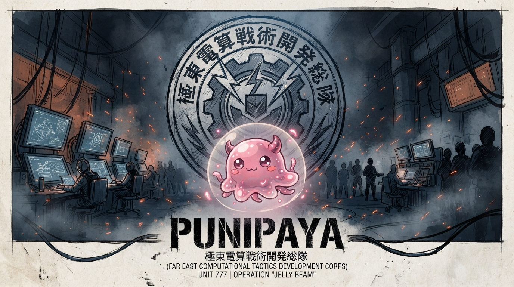

  

<h3 align="center">極東電算戦術開発総隊</h3>

<em>FAR EAST COMPUTATIONAL TACTICS DEVELOPMENT CORPS</em> UNIT 777 · OPERATION "JELLY BEAM"

---

## 概要

**PUNIPAYA** は、計算資源と戦術的発想を組み合わせて日々実験を重ねる開発部隊です。  
かわいい見た目に反して、中身は真面目なエンジニアリング。

## 活動領域

- ソフトウェア開発・自動化
- インフラ / クラウド / CI・CD
- データ処理・ツール制作
- 実験的プロトタイピング

## 運用方針

| 項目 | 内容 |
| --- | --- |
| 拠点 | Far East Computational Tactics Development Corps |
| 部隊番号 | UNIT 777 |
| 作戦名 | Operation "JELLY BEAM" |
| モットー | やわらかく、しかし正確に |

## 参加する

興味のある方は Issue や Pull Request からお気軽にどうぞ。  
小さな実験も、大きな作戦の一部です。

  © PUNIPAYA — Unit 777

